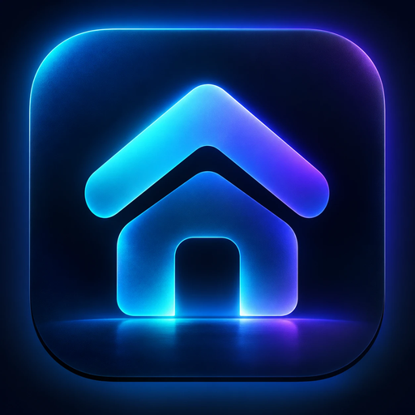
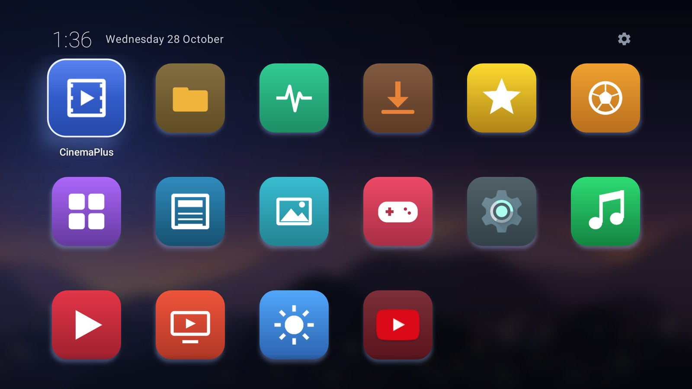
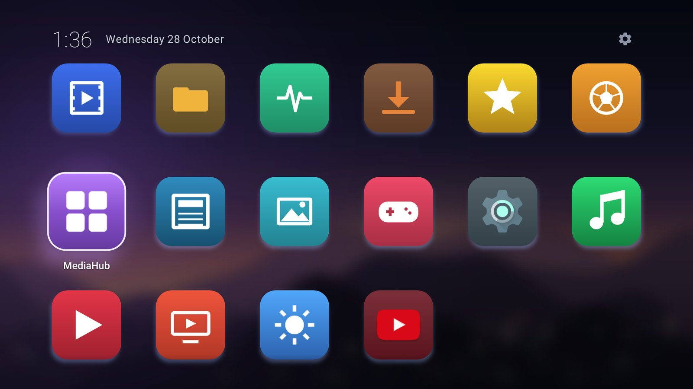
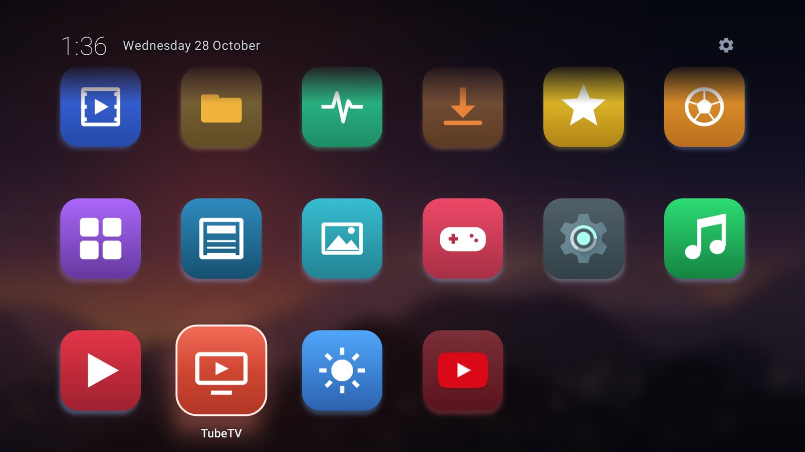
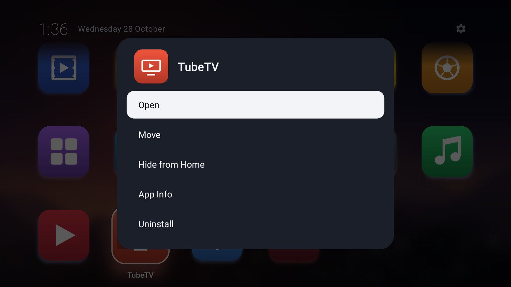
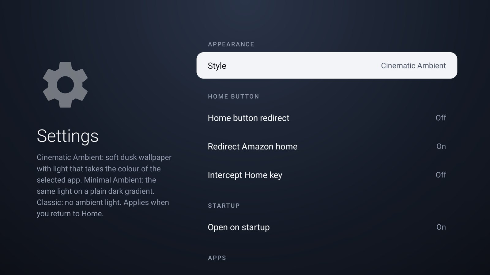
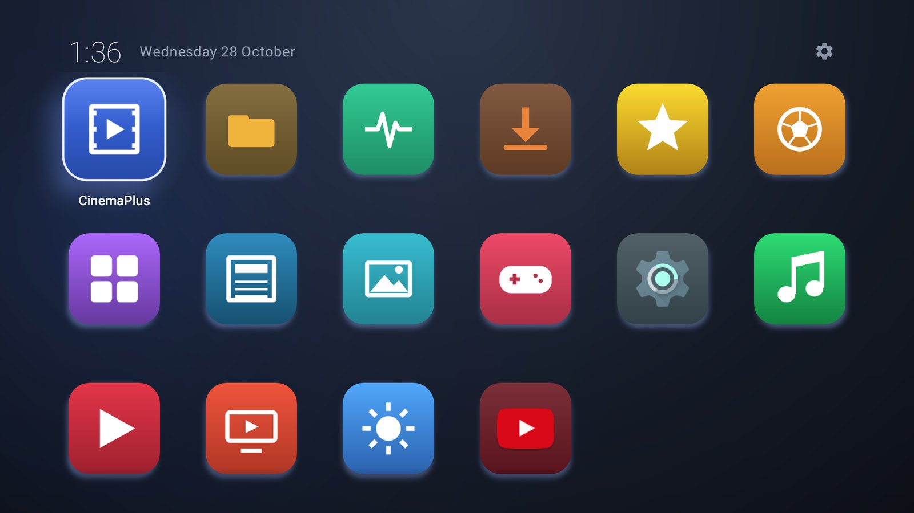
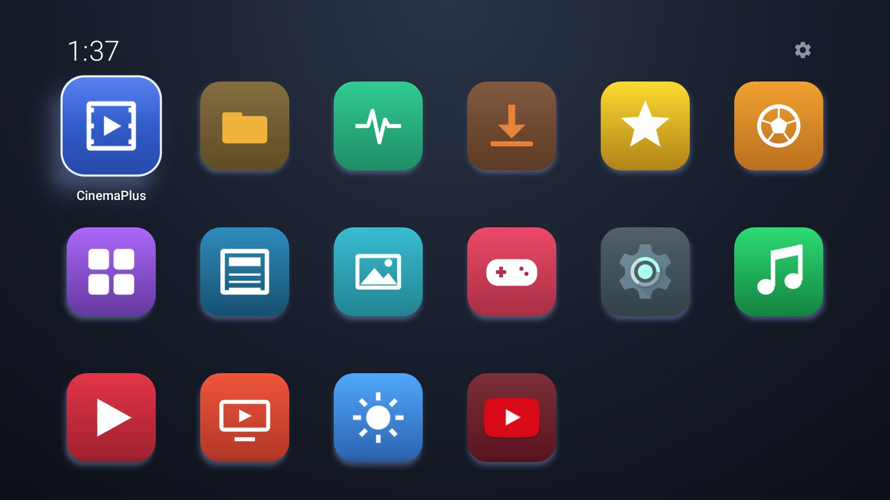

<p align="center">
  
</p>

<h1 align="center">Clean Launcher for Fire TV</h1>

<p align="center">
  <b>A calm, ad-free home screen for your Fire TV.</b><br>
  Just your apps — no adverts, no sponsored rows, no autoplaying trailers.
</p>

<p align="center">
  <a href="https://github.com/b3rtopacks/clean-launcher-releases/releases/latest"><b>Download the public beta (v0.9.0)</b></a>
  &nbsp;·&nbsp; Downloader code: <b>8477945</b>
  &nbsp;·&nbsp; Free
</p>

<p align="center">
  
</p>

> **Public beta.** Clean Launcher works well on the device listed below, but it is early software.
> It is an independent project and is **not affiliated with, endorsed by or supported by Amazon**.

---

## What it does

Clean Launcher is an app that shows a simple grid of the apps installed on your Fire TV, in a
dark, cinematic style. Once set up, pressing the **Home** button on your remote brings you to
Clean Launcher instead of Amazon's home screen.

- **Only your apps.** No adverts, recommendations or promoted content. Clean Launcher has no
  internet access at all.
- **Cinematic Ambient design.** A softly blurred dusk landscape with gentle light that takes on
  the colours of the app you've selected.
- **Made for the remote.** Everything works with the D-pad. The selected app grows slightly and
  shows its name; everything else stays quiet.
- **Make it yours.** Reorder or hide apps, and choose between three styles: Cinematic Ambient,
  Minimal Ambient and Classic.
- **Home button support.** The Home button and "Alexa, go home" take you to Clean Launcher.
- **Easy to undo.** Turn it off in its settings, or uninstall it, and the normal Amazon
  experience is back immediately.

<p align="center">
  
  
</p>
<p align="center">
  
  
</p>

<p align="center">
  
  
  <br><sub>The other two styles: Minimal Ambient and Classic.</sub>
</p>

<sub>Screenshots show the real Clean Launcher app, captured on an Android TV emulator at 1920×1080.
Most icons belong to placeholder test apps, so your screen will show your own apps.</sub>

## Tested devices

| Device | Software | Status |
|---|---|---|
| Fire TV Stick 4K (2nd Gen, 2023) | Fire OS 8.1.8.5 | ✅ Tested |
| Any other Fire TV device or Fire OS version | — | ⚠️ Not verified. It may work, but we haven't tested it. |

---

## Install

**Steps 1–4 are done entirely on your Fire TV with the remote.** After them, Clean Launcher works
as an app you open from your Apps list.

**Step 5 makes the Home button open Clean Launcher.** On Fire OS 8 this needs a computer (Windows or
Mac) on the same Wi-Fi, once, for about 5 minutes. It can't currently be done from the TV alone.
A phone such as an iPhone can't do this step.

### Step 1 — Install the Downloader app
1. On your Fire TV, go to **Find → Search** and search for **Downloader**.
2. Install **Downloader** (by AFTVnews). It's free.

### Step 2 — Allow Downloader to install apps
1. Go to **Settings → My Fire TV → Developer Options**.
   - Don't see **Developer Options**? Go to **Settings → My Fire TV → About**, highlight your
     device name (the first line) and press **Select** seven times. Then go back.
2. Select **Install unknown apps**, then switch **Downloader** to **ON**.

### Step 3 — Download Clean Launcher
1. Open **Downloader** (allow access to files if it asks).
2. In the box, type the code **8477945** and select **Go**.
   (Or type the full address instead:
   `https://github.com/b3rtopacks/clean-launcher-releases/releases/latest/download/CleanLauncher.apk`)
3. When the download finishes, select **Install**, then **Done**.
4. Downloader offers to delete the downloaded file. Select **Delete** — it's no longer needed.

The code and the address always point to the newest public beta.

### Step 4 — Open Clean Launcher
Open your **Apps** list on the Fire TV home screen and select **Clean Launcher**.
Tip: highlight it and press the remote's **Menu** (☰) button to move it somewhere easy to find.

At this point Clean Launcher works like any other app. The next step makes the **Home** button
take you to it.

### Step 5 — Set up the Home button (one time, needs a computer)

| | Where | Needed? |
|---|---|---|
| Turn on ADB Debugging | TV | Yes |
| Install Platform-Tools and connect | Computer | Yes |
| Grant permission (one command) | Computer | Yes |
| Allow opening after restart (one command) | Computer | Optional |
| Switch on "Home button redirect" | TV | Yes |
| Turn ADB Debugging off again | TV | Recommended |

Clean Launcher uses an Android **accessibility service** to notice when Amazon's home screen
opens and to show Clean Launcher instead. On Fire OS 8 this service is **not listed** in
**Settings → Accessibility** (checked on Fire OS 8.1.8.5), so it can't be switched on from the TV
menus. It needs a one-time command from a computer instead.

1. On the TV: **Settings → My Fire TV → Developer Options → ADB Debugging → ON**.
2. Find your TV's IP address: **Settings → My Fire TV → About → Network** (for example `192.168.1.50`).
3. On the computer, download **SDK Platform-Tools** from
   <https://developer.android.com/tools/releases/platform-tools> and unzip it.
4. Open a command window in the unzipped `platform-tools` folder:
   - **Windows:** open the folder, click the address bar, type `powershell` and press Enter.
   - **Mac:** open Terminal, type `cd ` (with a space), drag the folder into the window, press Enter.
5. Run these commands one at a time, using your TV's IP address.
   On Windows type `.\adb`; on a Mac type `./adb`.

   ```
   adb connect 192.168.1.50:5555
   ```
   The TV asks **Allow USB debugging?** — tick **Always allow from this computer** and select **OK**.
   If the computer says "failed to authenticate", run the same command again.

   ```
   adb shell pm grant com.b3rtopacks.cleanlauncher android.permission.WRITE_SECURE_SETTINGS
   ```
   Optional, helps Clean Launcher open after a restart:
   ```
   adb shell appops set com.b3rtopacks.cleanlauncher SYSTEM_ALERT_WINDOW allow
   ```
   These print nothing when they work. You can close the command window afterwards.
6. On the TV, open **Clean Launcher**, press **Up** to the ⚙ gear, select it, then select
   **Home button redirect** so it says **On**.
7. Test it: open any app and press **Home**. After a short black screen you'll see Clean Launcher.
8. Turn **ADB Debugging** back **OFF** (Developer Options). The Home button keeps working, including
   after a restart.

What the commands allow:
- The first lets Clean Launcher switch its own Home-button service on and off (step 6). Without
  it, Fire OS 8 offers no way to turn the service on from the TV.
- The optional second one lets it open itself after the TV restarts.

Neither gives Clean Launcher internet access; it has none.

---

## Turning it off and getting Amazon's home back

All of these are reversible.

| I want to… | Do this |
|---|---|
| Use Amazon's home screen for a moment | Clean Launcher → ⚙ → **Fire TV Home**. It stays until you open another app. |
| Stop the Home button redirect for now | Clean Launcher → ⚙ → **Redirect Amazon home → Off** |
| Switch the Home button feature off | Clean Launcher → ⚙ → **Home button redirect → Off** |
| Remove Clean Launcher completely | Press the remote's **Settings** (⚙) button → **Applications → Manage Installed Applications → Clean Launcher → Uninstall** |

After uninstalling, the Home button goes straight to Amazon's home screen again. Nothing else on
your Fire TV is changed.

Built-in safety: if Clean Launcher ever fails to open several times in a row, it stops redirecting
by itself so Amazon's home screen stays usable. Opening Clean Launcher once switches it back on.

## Updating

Install a newer version the same way: Downloader code **8477945** (or the address in Step 3)
always points to the newest public beta. It installs over the top and keeps your apps' order,
hidden apps, style and Home-button setup, because every version is signed with the same key. You
don't need the computer again.

**After updating, open Clean Launcher once** from your Apps list. Updating briefly stops Clean
Launcher, so Amazon's home screen may be showing when the update finishes. Opening Clean Launcher
once puts everything back to normal.

---

## Good to know (known limitations)

- **It doesn't replace Fire OS's own home screen.** Fire OS doesn't allow that. Clean Launcher
  reacts when Amazon's home opens and shows itself instead, so pressing **Home** gives a
  **short black screen (about 1–1.5 seconds)** before Clean Launcher appears.
- **The Home button needs the one-time computer setup** (Step 5). There is currently no
  TV-only way to do it on Fire OS 8. Without it, Clean Launcher still works as an app, but Home
  goes to Amazon's home screen.
- **After an update**, Amazon's home may be on screen until you open Clean Launcher once.
- **After an update**, Amazon's Apps grid may keep showing Clean Launcher's previous picture for a
  while; Fire OS caches app tiles. Settings → Applications shows the current icon.
- **Holding Home** still shows Amazon's quick menu. On Fire OS 8 it has no Settings entry —
  use the remote's **Settings** button instead.
- If you go to Amazon's home on purpose (⚙ → **Fire TV Home**), pressing Home there does nothing
  until you open any app or Clean Launcher.
- After a short sleep, the TV wakes up in the app you were using (normal Fire TV behaviour).
- The **Intercept Home key** option in settings is experimental and **does not work on Fire OS 8**.
  Leave it off.
- Amazon may change Fire OS in future updates, which could stop the Home button feature working.
  If that happens, Clean Launcher still opens as a normal app, and you can uninstall it at any time.

## Privacy

Clean Launcher has **no internet permission**, contains no adverts, analytics or tracking, and
stores its settings only on your TV. Its accessibility service is used for one thing: noticing
which screen has just opened, so it can tell when Amazon's home appears. It doesn't read what's on
screen or anything you type.

## Downloads and checksums

| Version | Files (identical) | SHA-256 |
|---|---|---|
| 0.9.0 beta | [CleanLauncher-0.9.0-beta.apk](https://github.com/b3rtopacks/clean-launcher-releases/releases/download/v0.9.0-beta/CleanLauncher-0.9.0-beta.apk), [CleanLauncher.apk](https://github.com/b3rtopacks/clean-launcher-releases/releases/download/v0.9.0-beta/CleanLauncher.apk) | `477429aa08f3c4a93b65dc9f38f1804729c41926422c0a04addab777fc1210d5` |

Newest version, always: <https://github.com/b3rtopacks/clean-launcher-releases/releases/latest/download/CleanLauncher.apk>

Every release is signed with the same key. Signing certificate SHA-256:
`cd234a053cc3107e2b48c3058c949e7266fc0131ff27ad450666021527e40a21`

Release notes: see [Releases](https://github.com/b3rtopacks/clean-launcher-releases/releases).
Problems or feedback: please [open an issue](https://github.com/b3rtopacks/clean-launcher-releases/issues).

---

<sub>Clean Launcher is free to download and use. It is an independent project, not affiliated with,
endorsed by or sponsored by Amazon.com, Inc. or AFTVnews. Amazon, Fire TV, Fire TV Stick, Fire OS
and Alexa are trademarks of Amazon.com, Inc. or its affiliates. Downloader is an app by AFTVnews.
This repository contains release builds and documentation only.</sub>
